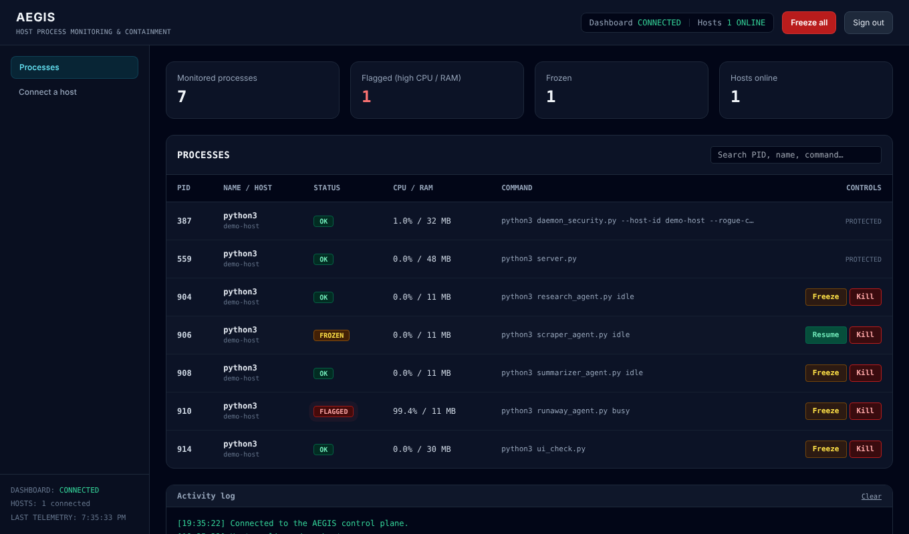

# AEGIS Core

**See what your AI agents and scripts are running, and freeze or kill a runaway one from a browser.**

AEGIS is a small control plane plus a host daemon, like a task manager but for AI. The daemon watches processes on a machine (by default anything named like `python`, `node` or `ollama`), reports CPU and memory every two seconds, and executes **freeze / resume / kill** when you ask from the dashboard.



## What it does

- Live process list per host, with a flag on sustained high CPU or very high memory.
- One-click **Freeze** (suspend), **Resume** and **Kill** (whole process tree), plus **Freeze all**.
- Multiple hosts on one dashboard.
- Operator login, daemon token, rate-limited sign-in, strict browser security headers.

## What it does not do (yet)

AEGIS Core is deliberately the process-containment layer only. It does **not** include an AI gateway, policy engine, persistent audit database, per-user accounts/roles, network firewalling or anomaly scoring. Control-plane actions (logins, commands, daemon acknowledgements) are written to the server log with an `AUDIT` prefix.

## Quick start (about two minutes)

Requires Python 3.10+.

```bash
python -m venv .venv
source .venv/bin/activate            # Windows: .venv\Scripts\activate
pip install -r requirements.txt
cp .env.example .env                 # then edit it (see below)
python server.py
```

Open <http://127.0.0.1:8000>. In a second terminal, on the machine you want to watch:

```bash
python daemon_security.py --host-id my-server
```

The dashboard's **Connect a host** tab shows the exact command for your server address. Within a couple of seconds the host appears under *Hosts online*.

### Configuration (`.env`)

| Variable | Purpose |
| --- | --- |
| `AEGIS_TOKEN` | Shared secret daemons must present (sent as an `Authorization` header, never in the URL). |
| `AEGIS_DASHBOARD_PASSWORD` | Operator password. Required for any non-local bind. Empty = local mode, no login. |
| `AEGIS_SESSION_SECRET` | Optional fixed key so logins survive a restart. |
| `AEGIS_SECURE_COOKIE` | Set `1` when served over https. |
| `AEGIS_HOST` / `AEGIS_PORT` | Bind address (default `127.0.0.1:8000`). |
| `AEGIS_WATCH` | Daemon side: process-name fragments to watch (default `python,node,ollama`). |

Generate a token: `python -c "import secrets; print(secrets.token_urlsafe(32))"`.

Daemon options: `--gateway`, `--host-id`, `--watch`, `--interval`, `--rogue-cpu`, `--rogue-scans`, `--rogue-rss-mb`. Run it as administrator/root to control processes owned by other users.

## Putting it on a network

The server **refuses to start on a non-local address** unless both `AEGIS_TOKEN` and `AEGIS_DASHBOARD_PASSWORD` are set. It does not terminate TLS: run it behind a reverse proxy (Caddy, nginx) and point daemons at a `wss://` URL. The daemon warns if it is about to send its token over plain `ws://` to a remote host. See [SECURITY.md](SECURITY.md).

## Safety rails

A tool that can kill processes must be hard to misuse:

- Only processes matching the watch list can be controlled.
- The daemon, its ancestors, `server.py` and `daemon_security.py` are protected; the dashboard shows no buttons for them.
- Commands carry the target's start time; if the PID has been reused by a different process the daemon refuses.
- Kill terminates children first, then the process, and reports if it survived.
- Every command is acknowledged by the daemon; the dashboard shows the real result.

`Kill` ends the whole process tree. Use it only on systems you are authorised to administer.

## Development

```bash
pip install -r requirements-dev.txt
ruff check .
python -m pytest
```

CI runs both on Python 3.10–3.13 (Linux). The suite starts real child processes to test suspend/resume/kill and PID-reuse refusal, and exercises login, cookies, token auth and the daemon-to-dashboard relay.

The dashboard has no build step to run: `web/assets/tailwind.css` is committed. To change styling, edit `web/src/input.css` or the classes in `web/*.html` / `web/assets/app.js` and rebuild with the [Tailwind CSS v3 standalone CLI](https://github.com/tailwindlabs/tailwindcss/releases/tag/v3.4.17):

```bash
tailwindcss -c tailwind.config.js -i web/src/input.css -o web/assets/tailwind.css --minify
```

### Layout

```
server.py            control plane (FastAPI): login, WebSocket hub, command relay
daemon_security.py   host daemon: scan, freeze/resume/kill, safety rails
web/                 dashboard + login page (no CDN, no inline scripts)
tests/               pytest suite
```

## Platform notes

Developed and tested on Linux. Suspend/resume uses `SIGSTOP`/`SIGCONT` on Linux and macOS and `NtSuspendProcess` on Windows; the Windows and macOS paths are not covered by CI.
